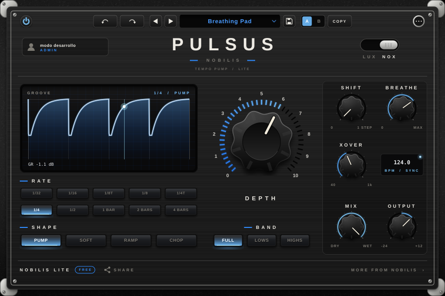

# NOBILIS LITE — Nobilis  ·  v1.0.0

Pack gratis de cuatro efectos de una perilla, con la estética de IGNIS y ACIES (LUX / NOX). La idea es simple: resultado inmediato con un solo gesto, completos y sin límites, para llegar a más gente y llevarla a la cuenta de Nobilis.

| Plugin | Qué es | Perilla grande | Lo que lo hace Nobilis |
|---|---|---|---|
| **PULSUS** | Pump sincronizado al tempo (sidechain sin sidechain) | DEPTH | BAND (bombea solo graves o solo agudos) y BREATHE (filtro que respira con el pump) |
| **ADEPS** | Gordura instantánea: compresión + saturación + clip | FATNESS | COLOR recorre tres etapas de filtro analógico (LADDER, OTA, SALLEN-KEY), cada una satura distinto |
| **LATUS** | Chorus bucket brigade de los poly de los 80 | WIDTH | Modo ENSEMBLE (string machine), AGE (envejece el BBD) y BASS MONO |
| **VETUS** | Máquina lo-fi | AGE | Cuatro medios: TAPE, VINYL, SAMPLER y RADIO; el ruido se compuerta con la música |



## Licencia

Una sola licencia para los cuatro: el producto `lite` del sistema Nobilis. Cualquier cuenta (nueva o vieja) la tiene gratis y completa; no hace falta cargarla a mano. El backend ya está preparado en `nobilis-web` (`plugin.mjs`, constante `FREE_FOR_ALL`).

- **Con sesión**: todo habilitado.
- **Sin sesión**: el audio pasa sin procesar y aparece el cartel para iniciar sesión (igual que IGNIS).
- `-DLITE_REQUIRE_LOGIN=OFF`: build de desarrollo, funciona sin servidor ("modo desarrollo / ADMIN").

## Cada plugin

### PULSUS · pump

- **DEPTH**: profundidad del pozo.
- **RATE**: 1/32, 1/16, 1/8T, 1/8, 1/4T, 1/4, 1/2, 1 BAR, 2 BARS y 4 BARS. Sigue el playhead del DAW; si el transporte está parado, sigue solo desde la última posición.
- **SHAPE**: PUMP (compresor de bus), SOFT, RAMP y CHOP (trance gate).
- **SHIFT**: corre el pozo dentro del paso, para contratiempos.
- **BAND**: FULL, LOWS o HIGHS, con corte Linkwitz-Riley en **XOVER** (40 Hz a 1 kHz).
- **BREATHE**: pasa-bajos que se cierra en el pozo y se abre al volver.
- **MIX** y **OUTPUT**.
- 14 presets en 4 categorías (House & Techno, Bass, Trance & Gates, Subtle & Mix Bus).

### ADEPS · gordura

- **FATNESS** es una macro: mueve a la vez la compresión (1:1 a 4:1), el drive del shaper (0 a +24 dB) y el clip final, cada uno con su curva. Saturación con oversampling 4x.
- **COLOR**: LADDER (oscuro y redondo, armónicos impares), OTA (cremoso, pares) y SALLEN-KEY (brillante y agresivo). Las posiciones intermedias se interpolan.
- **GAIN** de entrada con lámpara: se sube hasta que se pone verde.
- **MIX**, **OUTPUT** y **AUTO GAIN** (compara a volumen parejo).
- 13 presets (Drums, Bass, Synths & Vocals, Mix & Master).

### LATUS · chorus

- Dos líneas tipo BBD en contrafase (una por lado): el estéreo ancho de los pads clásicos desde una fuente mono.
- **MODE**: I (0,51 Hz), II (0,86 Hz), I + II (9,75 Hz, casi rotary) y ENSEMBLE (tres voces a 120° + vibrato).
- **WIDTH**: macro de nivel wet y profundidad.
- **SPEED**, **AGE** (filtros más oscuros, compander y hiss compuerteado), **MIX**, **OUTPUT** y **BASS MONO** (todo lo que está debajo de 150 Hz queda seco y al centro).
- 12 presets (Synths, Keys & Guitars, Bass & Vocals, Lo-Fi & Texture).

### VETUS · lo-fi

- **MEDIUM**: TAPE (wow y flutter, head bump, saturación, hiss), VINYL (wow de 33 rpm, crujido, pops, rumble), SAMPLER (12 bits, sin filtro anti-alias) y RADIO (AM: pasa-banda, mono, clipping, estática).
- **AGE**: macro de casi nuevo a encontrado en un sótano.
- **NOISE**, **WOBBLE**, **MIX**, **OUTPUT** y **GATE NOISE** (el ruido solo suena con música; el tema termina en silencio).
- 12 presets (Tape, Vinyl, Sampler, Radio).

## Lo que comparten (core/)

Todo lo que no es DSP está en `core/` y es igual en los cuatro, así un plugin nuevo es solo su motor, su editor y su `Product.cpp`:

- `LiteProcessor`: parámetros, bypass con latencia compensada, mono/estéreo, estado, smoothing.
- `PresetManager` + `PresetBar` + `PresetBrowser`: presets de fábrica y de usuario, UNDO / REDO, A/B / COPY.
- `NobLookAndFeel` + `Widgets`: chapa, perillas, botones, LUX / NOX, escalado de ventana.
- `license/`: login por código de dispositivo, licencia firmada (Ed25519, Monocypher) y aviso de versión nueva.
- `LiteEditor`: encabezado, pie con **FREE**, **SHARE** y **MORE FROM NOBILIS**.
- `Translations.h`: español e inglés.

### SHARE

Guarda en el Escritorio (carpeta "Nobilis PULSUS", etc.) una imagen 1080 × 1350 (el formato vertical que Instagram muestra sin recortar) con la interfaz, el nombre del preset y "FREE AT NOBILIS.AR/LITE", más el archivo del preset al lado. La captura nunca muestra la cuenta ni el email. `nobilis.ar/lite` redirige a la página del pack (`netlify.toml`).

## Compilar

```bash
cmake -B build -DCMAKE_BUILD_TYPE=Release            # baja JUCE 9.0.4 solo
cmake --build build --config Release --parallel
```

Opciones:

- `-DJUCE_DIR=...`: usar una copia local de JUCE.
- `-DLITE_REQUIRE_LOGIN=OFF`: build de desarrollo, sin servidor.
- `-DLITE_DIAGNOSTICS=OFF`: sin log de diagnóstico (releases).
- `-DLITE_BUILD_TESTS=ON`: tests offline.
- `-DLITE_VST2_SDK=...`: suma VST2 si tenés el SDK viejo.

Formatos: VST3 y Standalone (más AU en macOS). Binario universal en macOS (Apple Silicon + Intel), macOS 10.15 o superior.

## Tests

```bash
cmake -B build -DLITE_BUILD_TESTS=ON -DLITE_REQUIRE_LOGIN=OFF
cmake --build build --target PULSUS_Tests && build/PULSUS_Tests_artefacts/Release/PULSUS_Tests
```

Cada plugin verifica: presets de fábrica, silencio y NaN, bypass igual a la entrada (con la latencia), layouts mono y estéreo, guardar / cargar estado y uso de CPU. Con `snapshot` y `card` el mismo binario renderiza la interfaz y la imagen de SHARE (`tools/snapshots.sh` actualiza `docs/`).

## Releases

GitHub Actions (`.github/workflows/build.yml`) compila los cuatro en Windows y macOS, corre los tests, valida con pluginval (y auval en Mac) y arma **un solo instalador** por sistema:

- `NOBILIS-Lite-Setup-Windows.exe` (Inno Setup; se puede elegir qué plugins instalar).
- `NOBILIS-Lite-macOS.pkg` (VST3 + AU, apps Standalone opcionales).

Publicación (el repo es público, así que las releases sirven de descarga y no hace falta ningún token):

- **Sin recompilar**: Actions → **Publicar release** → el ID de una corrida de *Build NOBILIS LITE* hecha con login y la versión. Crea la release `vX.Y.Z` con los dos instaladores.
- **Con un tag** `vX.Y.Z`: compila esa versión y la publica igual.

Los links quedan en `https://github.com/produccionmusicaargentina-dev/nobilis-lite/releases/download/vX.Y.Z/…`, que es lo que usa la web. Para una versión nueva, cambiá `LITE_VERSION` en Netlify (o el valor por defecto en el código de la web).
